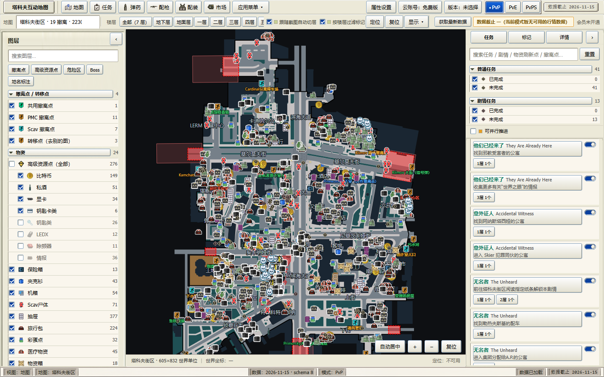
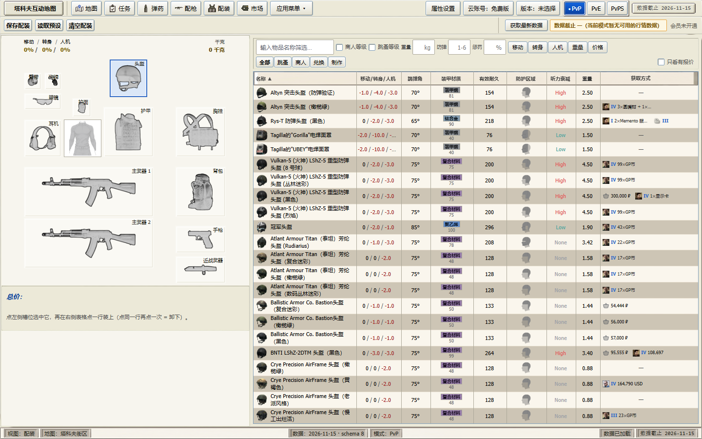
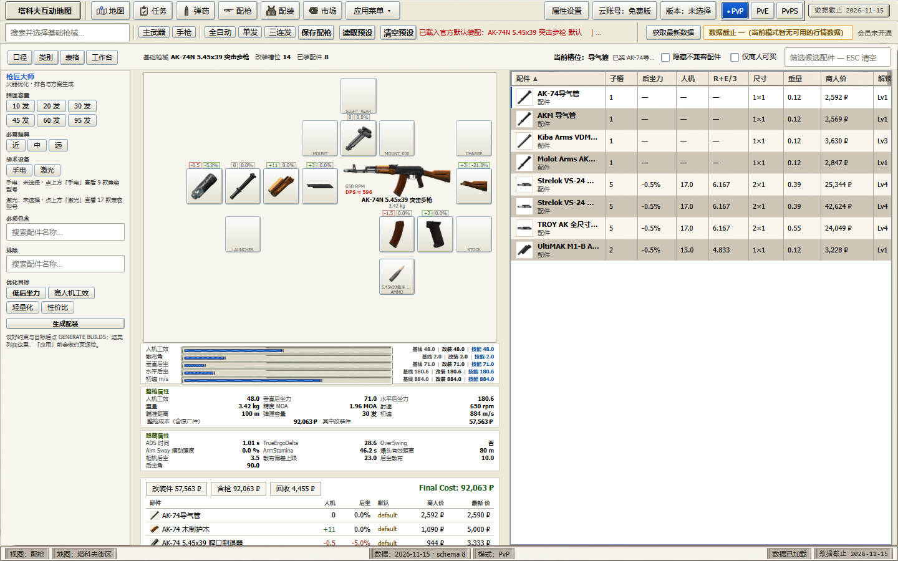
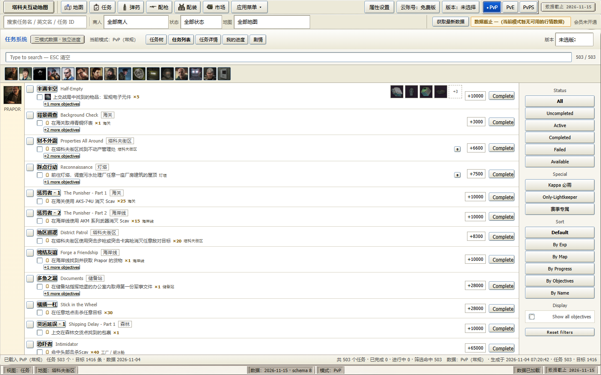
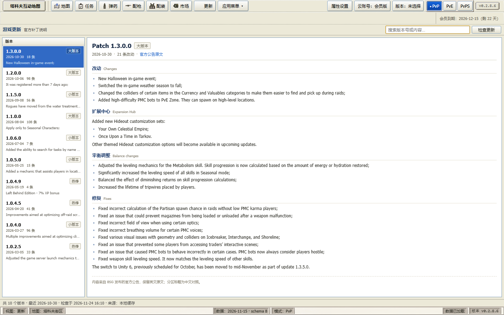

# EFT 互动地图

一款给《逃离塔科夫》玩家用的本地互动地图工具。地图查询、实时定位、路线规划、任务监控、配装和配枪都在同一个窗口里。

当前源码版本 **0.2.9.0**，Windows 平台，个人使用永久免费。

[下载发布包](https://github.com/jjingith/eft-interactive-map/releases) · [详细使用说明](docs/USAGE.md)

## 界面

主地图：底图、图层开关和点位标注。



配装工作台：左侧装备槽位，右侧候选装备，顶部汇总件数、重量和价格。



配枪工作台：选中枪械后的改装槽位树与合法配件列表。



任务视图：按商人和状态筛选任务，标记已完成与未领取奖励。



游戏更新：左边版本时间线，右边是该版本的改动、平衡与修复。



## 能做什么

**地图与点位。** 内置 15 张地图，包括 13 张常用图和实验室疫区、工厂疫区两张变体。物资、撤离点、出生点、Boss、危险区、上锁点和高级资源点都标在图上，多楼层地图可以切层查看。左侧图层可分组开关，图标和地名的大小、透明度都能单独调整。底图支持矢量图和官方 Wiki 两种模式。

**战局辅助。** 读取游戏截图文件名里的坐标和朝向，在地图上显示玩家位置和朝向。跟随游戏日志识别战局开始、结束和任务事件，进图时自动切到对应地图。可选的自动截图会在战局中按间隔让游戏自己截图；配套开关可读出位置后清理多余截图。这两项默认关闭。

**搜索与导航。** 按名称搜索地图点位，把结果钉在搜索栏下方，或选几个点连成路线。同一楼层的相邻途经点按底图路网寻路，给出沿路里程，途经点可以拖动排序。

**配装与配枪。** 配装工作台点槽位驱动右侧候选装备表，可选护甲板、检查装备冲突，并统计重量、价格和属性减益。配枪工作台收录 163 把枪械，列出合法配件；冲突件标红禁装，换父件会自动清理失效子槽。配装和枪械预设都保存在本地，换安装目录也能恢复。

**游戏更新。** 「更新」页按版本列出官方补丁说明：左边是版本时间线（大版本 / 小版本 / 热修），右边是这一版改了什么，按改动、平衡调整、修复分区。内容来自 BSG 发在 Steam 上的官方公告，随包带最近 10 个版本的离线快照；点「检查更新」会再抓一次最新公告并缓存到本地。补丁正文保留英文原文（只把分区标题做了中文对照），避免翻译走样。

## 下载与安装

发布包有三个版本，程序相同，区别只在安装和界面的打开方式。普通用户按自己的习惯选一个即可。

| 版本 | 适合谁 |
| --- | --- |
| `EFTMap-Setup-*.exe` | 想要一键安装，自动建快捷方式和卸载项 |
| `EFTMap-Portable-*.zip` | 不想安装，解压后直接双击 `EFTMap.exe` |
| `EFTMap-AppWindow-*.zip` | 想要独立应用窗口，不占浏览器标签页 |

不需要装 Python，也不需要装任何运行库。

1. 下载任意一个版本，安装或解压；
2. 双击 `EFTMap.exe`，在弹出的小窗里核对游戏目录和截图目录（留空会自动找）；
3. 点「启动 WebUI」，服务起来后浏览器会打开地图界面。

配置和自定义提示音存在 `%APPDATA%\EFTMap\`，重新打包或换目录解压都不会丢。高级参数和完整排查步骤见 [docs/USAGE.md](docs/USAGE.md)。

安装包可在 [Releases](https://github.com/jjingith/eft-interactive-map/releases/latest) 下载，以页面标注的最新版本为准。

## 工作原理与安全

默认完全本地运行，不联网，只监听 `127.0.0.1`。不读取游戏内存，不注入游戏进程，不改游戏文件。定位来自截图文件名里的坐标，任务事件来自游戏写在磁盘上的日志。

有两个功能需要单独说明：

- **在线行情**：默认关闭。手动开启后才会访问 tarkov.dev 取更新的价格，失败会退回内置的离线快照。开启前本页面一直是离线的。
- **自动截图**：默认关闭。开启后会在游戏窗口处于前台时模拟按下截图键，让游戏自己写图。

自动截图会向游戏发送模拟输入，存在被反作弊误判的可能。本工具不读内存、不注入进程，但不能保证不会被误判。介意的话保持默认关闭即可。

## 地图与数据来源

内置地图：塔科夫街区、中心区、海关、工厂、破冰船、立交桥、实验室、迷宫、灯塔、储备站、海岸线、码头、森林，以及实验室疫区、工厂疫区。全部标注合计 18266 条。13 张常用图都有底图，其中 10 张是矢量 SVG，实验室、迷宫、破冰船由上游瓦片在构建期拼成。

当前限制：

- 路线规划只在同一楼层沿道路寻路。跨楼层，以及实验室、迷宫、破冰船这三张只有瓦片底图的地图，途经点之间是直线连接，会穿墙。
- 自动截图要求游戏窗口在前台，更适合游戏全屏、地图放副屏或手机上看。
- 灯塔、森林、迷宫是单层图；码头在上游数据里没有撤离点和地名。

数据来自 [tarkov.dev](https://tarkov.dev/) 与 [the-hideout/tarkov-dev](https://github.com/the-hideout/tarkov-dev)，底图沿用 CC BY-NC-SA 4.0 许可，需要署名且不得商用。物品图标来自 assets.tarkov.dev，同样要求署名和非商业使用。每个来源的地址、校验值和许可都记在 `data/meta.json` 里，界面侧栏底部也有注明。

《逃离塔科夫》的商标和原始美术归 Battlestate Games 所有。本项目不含游戏资源文件。

## 开发者

从源码运行需要 Python 3.9+。运行期只用标准库，前端是原生 JS/CSS，没有构建步骤。

```bash
python tools/fetch_data.py    # 首次：联网拉取数据与底图，只需一次
python tools/launcher.py      # 启动设置小窗与本地服务
```

只调试前端时可以跳过启动器：

```bash
python tools/serve.py --no-browser --port 8790
```

不要用 `file://` 直接打开 `index.html`，浏览器会拦截本地数据读取。

打包与发布：

```powershell
powershell -ExecutionPolicy Bypass -File build\build.ps1
powershell -ExecutionPolicy Bypass -File build\build_release.ps1
```

版本号以 `tools/serve.py` 的 `VERSION` 为准，当前 0.2.9.0。PyInstaller 只在构建期需要。

测试用 pytest，全部离线运行：

```bash
python -m pytest tests -q
node --check app.js
```

最近一次全量结果为 2572 个用例、20 个失败、1 个跳过。其中 18 个是长期存在的基线失败（实时行情接口相关，test_r42 / test_r44 与 test_r215），另外 2 个在单独运行时通过，属于并发测试时的状态竞争。这些失败没有被跳过，也没有弱化。

目录结构、数据管道、各图标注计数和更多命令见 [docs/USAGE.md](docs/USAGE.md)；界面组件的规范和用法见 `docs/ui-system/`。

## 免费与许可

本软件永久免费，不设付费版，也不提供付费优先支持。如果你付费买到了，说明被转卖了，请回到本项目页面免费获取。

底图部分采用 CC BY-NC-SA 4.0 许可，再分发需保持同一许可并署名。项目其余部分的数据来源与对应义务见上文。

版权所有人：jiajun zhou · 项目主页：https://github.com/jjingith/eft-interactive-map

如果想支持开发，可以到[爱发电](https://afdian.com/a/jiajun2160)请我喝杯咖啡。完全自愿，不会带来额外功能或优先支持。
